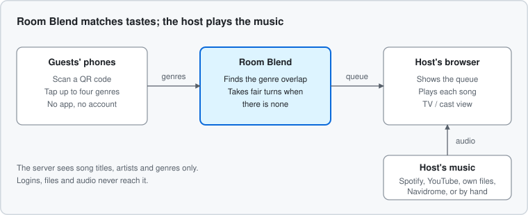
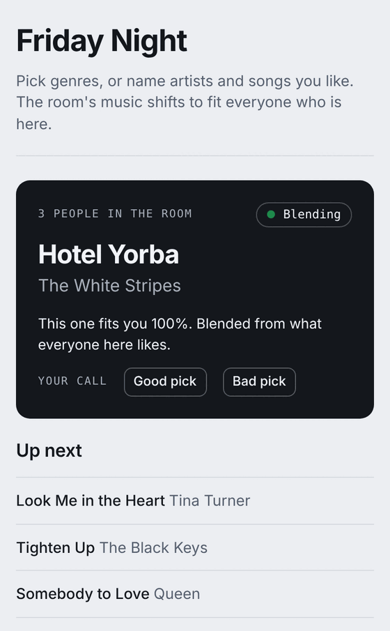
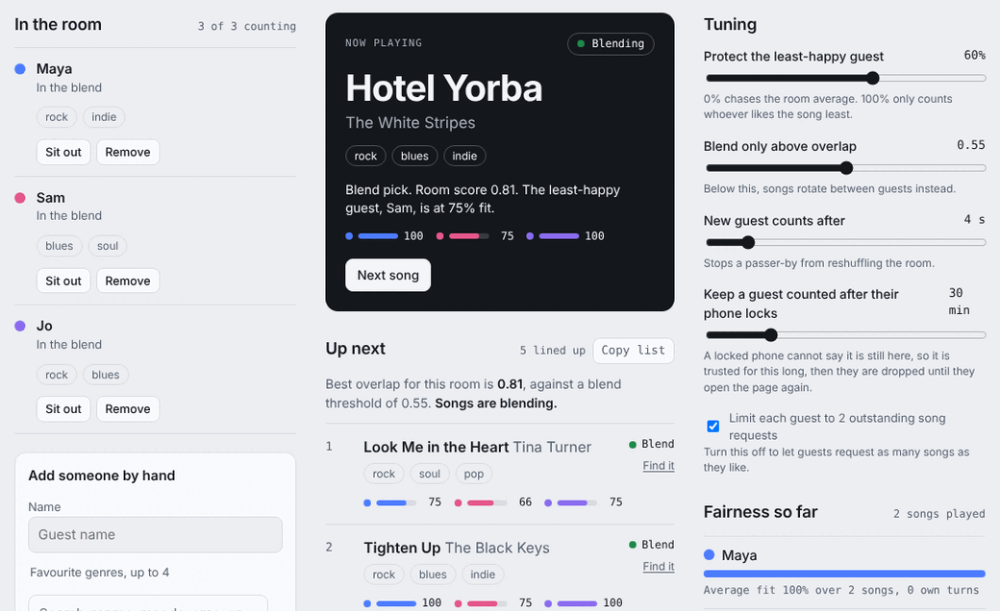
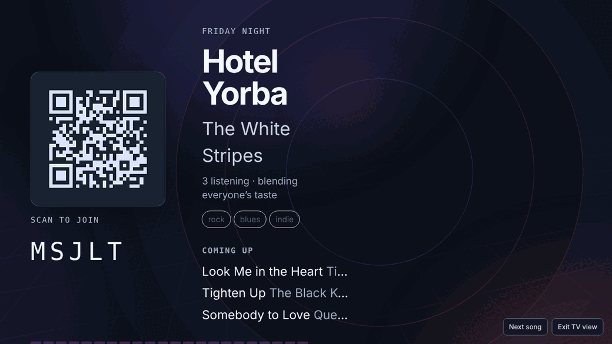

# Room Blend

A Modern jukebox that blends music discovery and sharing with a group or solo.

In a shared space, one person's playlist usually wins and everyone else tunes out. With Room Blend, each person picks a few genres on their phone and the room plays songs from what they have in common. When there's no overlap, it takes fair turns so everyone gets heard.

Room Blend only decides what plays next. The host's own music service plays the songs, so there are no streaming accounts to manage. Everything is run in the host's browser.

## How it works

1. The host starts a room and says where their music is: Spotify, a folder of files, a Navidrome server, or YouTube.
2. No login - guests scan a QR code and pick genres and artists for their tastes.
3. Songs come from a shared genre mashup of all guests selections.
4. The queue automatically adjusts as people come and go.

Guests can also join from a short link, from the "Playing near you" list on the same Wi-Fi, or by typing the 5-letter room code. Once in, they can name artists and songs they like, or request a song for the host to play.

### Duels

Guests who both have a song waiting can duel for its place in line. On the TV / cast view their avatars walk to the middle of the floor, with a name tag and health bar over each head, and play a few quick rounds of Strike, Feint and Guard (Strike beats Feint, Feint beats Guard, Guard beats Strike) picked secretly on their phones. Now and then a Chaos Card changes the rules for a round. The winner's request moves up 2 to 4 places; the loser's never drops.

To keep it fair, each guest can declare only a few challenges per window of time, nobody can be pulled into back-to-back duels, and the room runs one duel at a time. The host sets the allowance and window (or turns duels off) under **Duels** in the host console, and can call off a duel in progress.

## What it looks like

<table>
  <tr>
    <td rowspan="2" align="center" valign="middle">
       
      A guest's phone
    </td>
    <td align="center">
       
      The host console: who is here, what is playing, and how fairly everyone is served
    </td>
  </tr>
  <tr>
    <td align="center">
       
      TV / cast view: scan to join, with the queue on show
    </td>
  </tr>
</table>

## Quick start (Hosting the server)

You need Node 22 or newer. There is nothing to install.

    node server.js

Open <http://127.0.0.1:3000> and press **Start a room**. To let phones on your Wi-Fi join, set `PUBLIC_URL` to your machine's address. [docs/SETUP.md](docs/SETUP.md) walks through it.

With Docker:

    docker build -t room-blend . && docker run -p 8080:8080 -v rb-data:/data room-blend

## Music sources

The host picks one per room. Guests never need any of these.

| Source | What you need |
|---|---|
| Spotify | Needs Premium |
| My music files | A folder of songs on your computer. Files stay in your browser |
| YouTube | A free Google API key. Subject to API Rate Limits set by Google |
| Navidrome / Subsonic | Your own music server |

Each host creates their own Spotify app because Spotify limits development-mode apps to five users and grants wider access only to established products. If you have extended access, set `SPOTIFY_CLIENT_ID` and hosts can use your app instead.

Details on each source, how matching works, and how to add a new one are in [docs/PROVIDERS.md](docs/PROVIDERS.md).

## Documentation

- [docs/SETUP.md](docs/SETUP.md): running it, letting phones join, connecting music, running several rooms, going online, and the [settings reference](docs/SETUP.md#settings-reference)
- [docs/DATABASE.md](docs/DATABASE.md): optional Postgres (Neon free tier) for room persistence and a shared YouTube catalogue
- [docs/PROVIDERS.md](docs/PROVIDERS.md): [how music sources work](docs/PROVIDERS.md#two-kinds-of-source), [adding one](docs/PROVIDERS.md#adding-a-source), and [genres](docs/PROVIDERS.md#genres)

## Free ways to run it

- **Your laptop plus a Cloudflare Tunnel.** Run `node server.js`, then `cloudflared tunnel --url http://localhost:3000`, and set `PUBLIC_URL` to the tunnel address. Good for trying it with friends tonight.
- **Render free web service.** `render.yaml` is included. The service sleeps when idle. Add a free [Neon Postgres](docs/DATABASE.md) and rooms, their checkpoints and one shared YouTube catalogue live on the server side; without it, the host's browser keeps a snapshot and restores the room when the service wakes.
- **Oracle Cloud Always Free VM.** Always on, but you manage a small Linux server.
- **Fly.io.** `fly.toml` is included. It asks for a card and costs a few dollars a month.

It needs a long-running server, so serverless platforms like Vercel and Netlify won't work. More in [docs/SETUP.md](docs/SETUP.md#5-when-you-want-it-outside-your-home).

## Privacy

The server only sees song titles, artists and genres. With a database, it also keeps rooms (guest data inside an encrypted checkpoint) and a shared catalogue of songs and playback results; see [docs/DATABASE.md](docs/DATABASE.md#how-it-behaves). Audio, files and music-service logins stay in the host's browser. Logs don't contain names, picks, room codes or IP addresses.

## Status

Room Blend works end to end: host console, guest page, live queue, big-screen view and the music sources above. Expect rough edges. If something breaks, please open an issue. Even better, fix the issue.

Spotify is for private listening, so use Room Blend at home or with friends, not in a business.

## License

Apache License 2.0. See [LICENSE](LICENSE).

## Development

    npm test                # engine, tag reader (needs ffmpeg), API
    npm run test:browser    # end-to-end tests. Needs Playwright, ffmpeg and Python OpenCV

Where things live:

    server.js           HTTP, live updates, limits, room recovery
    lib/                engine.js (blending and turns), room.js (room state), built-in song list
    public/             the UI and the music source modules
    docs/               setup and provider guides
    test/               engine, API and browser tests
